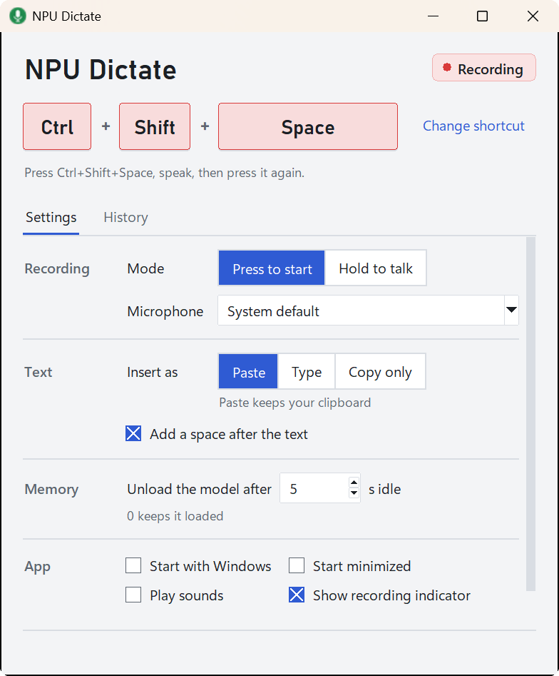
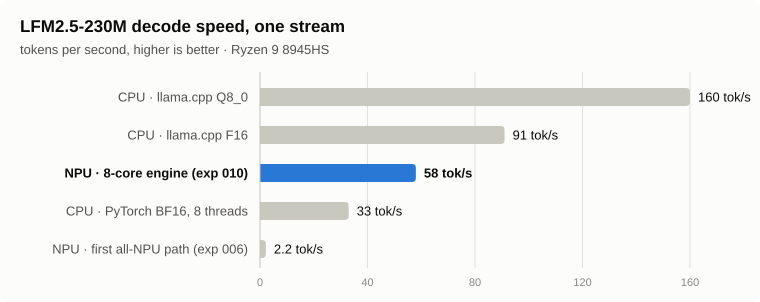
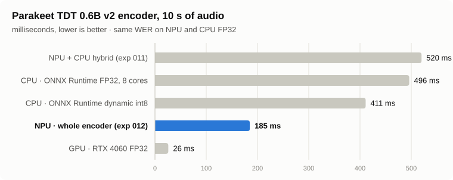
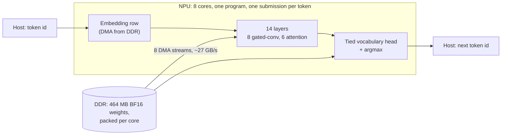
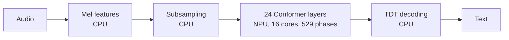

# Ryzen AI NPU Lab

[](https://github.com/AbhiramJayasankar/ryzenai-npu-lab/actions/workflows/ci.yml)
[](LICENSE)

**A language model and a speech-recognition model running on the AMD Ryzen AI
NPU, with hand-written AI Engine kernels.**

AMD's LLM runtime does not support the first-generation XDNA NPU (Phoenix /
Hawk Point), and its model compiler could not run the speech model usefully
there. This repository skips both. The engines target the NPU's compute
tiles directly through AMD's open IRON / MLIR-AIE toolchain, with C++ kernels
and Python data-movement designs, and run through XRT. Each experiment checks
its output against a CPU reference and compares speed with the strongest CPU
and GPU baselines on the same laptop.

| | Result on a Ryzen 9 8945HS laptop |
| --- | --- |
| **LLM:** [Liquid AI LFM2.5-230M](https://huggingface.co/LiquidAI/LFM2.5-230M), all arithmetic on the NPU | **58 tokens/s** (17.2 ms per token), 26× faster than this lab's first NPU version and at the NPU's measured memory-bandwidth limit. Matches the CPU BF16 reference token for token, except where the CPU's top two choices tie exactly. |
| **Speech to text:** [NVIDIA Parakeet TDT 0.6B v2](https://huggingface.co/nvidia/parakeet-tdt-0.6b-v2), whole encoder on the NPU | **185 ms per 10 s of audio**, 2.7× faster than the CPU in FP32, with **exactly the FP32 word error rate** (2.19% on 210 LibriSpeech utterances). |
| **Reliability** | NPU hangs that crashed Windows twice were traced to a hardware queue overflow. A static checker now rejects unsafe programs before they reach the NPU, and 566 submissions have run since then without a hang. |
| **App** | [NPU Dictate](apps/npu_dictate/README.md): press a shortcut, speak, and the text goes into any window, with speech recognition on the NPU. A portable 43 MB download ([releases](https://github.com/AbhiramJayasankar/ryzenai-npu-lab/releases)) that needs only the AMD NPU driver: no Python, IRON or compiler. |





Both recordings are real runs on the laptop, captured with
[`docs/demo/record.py`](docs/demo/record.py). Tokens appear at the recorded
speed. The model-loading wait is shortened, and the typed input is replayed
at typing speed ([`render.py`](docs/demo/render.py) lists every edit). For
the full story, read the [technical write-up](docs/writeup.md).

<picture>
  <source media="(prefers-color-scheme: dark)" srcset="docs/img/npu_dictate_dark.png">
  
</picture>

<picture>
  <source media="(prefers-color-scheme: dark)" srcset="docs/img/llm_decode_dark.svg">
  
</picture>

<picture>
  <source media="(prefers-color-scheme: dark)" srcset="docs/img/stt_encoder_dark.svg">
  
</picture>

**The honest comparison.** The NPU is not the fastest way to run these models
on this laptop. llama.cpp on the CPU decodes the LLM faster (91 tok/s in F16)
because the CPU reads memory faster than the NPU's ~27 GB/s, and the RTX 4060
runs the speech encoder 7× faster than the NPU. What the NPU offers is
inference that leaves the CPU and GPU free. Most of the work in this
project went into measuring the NPU's limits and designing each engine
around them.

## The LLM engine



Decoding one token means reading all 464 MB of BF16 weights from DDR, so the
design starts from one measurement: the NPU's DMA channels read DDR at about
27 GB/s when 8 streams run at once. The engine
([experiment 010](experiments/010_x8_engine.md)) is built so that the NPU
does nothing but stream weights at that rate:

* **Eight cores, one DMA stream each.** Core *k* owns slice *k* of every
  projection. The host repacks the weights into the order each core reads
  them, so every stage is one long transfer.
* **Partitioned so that work stays local.** Each core holds 128 channels of
  the gated convolution and one KV head of grouped-query attention, so a
  layer needs only four exchanges of full vectors.
* **One submission per token.** All 14 layers, the vocabulary head and the
  argmax run as one NPU program. The embedding is a DMA straight from the
  table row, and the NPU writes back the chosen token id.
* **One core program for every layer type.** Switching programs costs
  ~0.5 ms, so a small C++ state machine
  ([`x8_core.cc`](experiments/kernels/x8/x8_core.cc)) handles recurrent
  layers, attention and the head. It fits the 16 KB program memory with 156
  bytes to spare.
* **Batched prompts.** A second core program processes four prompt tokens
  per weight pass, at 4.6 ms per prompt token.

At 27 GB/s the weights take 12.4 ms (layers) + 5 ms (head) per token. The
measured 17.2 ms is at that floor, so BF16 decode cannot get meaningfully
faster on this NPU. The next step would be to read fewer bytes (INT8 weights).

**How it got from 450 ms to 17 ms per token:**

| Step | ms per token | What changed |
| --- | ---: | --- |
| First all-NPU version (experiments 006–009) | ~450 | one core per layer, ~3,000 small synchronized transfers per layer, many program switches |
| 8 cores, one stream each, direct XRT | 46 | measured the DDR ceiling first; one long DMA per stage |
| Vectorized norm, SiLU and convolution | 32.6 | these AIE cores have no scalar FPU, so scalar float math cost ~1 ms per layer |
| One core program for both layer types | 28 | removed ~0.5 ms program switches |
| Whole token in one submission | **17.2** | ~15 submissions per token down to 1 |

## Speech to text on the NPU



[Experiment 011](experiments/011_parakeet_npu.md) tried the official route
first. Ryzen AI's quantizer and Vitis AI execution provider placed this
Conformer model on the Phoenix NPU only with XINT8 quantization. That
version split every layer into about ten pieces, ran slower than the CPU and
had 38% relative error after two layers. A hybrid with all matrix multiplies
as custom NPU GEMMs matched the FP32 accuracy, but only at CPU speed.

[Experiment 012](experiments/012_all_npu_encoder.md) moves the whole encoder
onto all 16 compute tiles with a single core program: GEMMs on the matrix
unit (BF16 in, FP32 accumulate), LayerNorm, relative-position attention with
online softmax, and the convolution module. Two numerical fixes mattered
most:

* Setting FP32→BF16 rounding to round-to-nearest-even (the hardware default
  truncates) cut the error from 6–16% to 1.1–1.9%.
* Building exp, sigmoid and Swish from native BF16 multiply-accumulates
  instead of emulated FP32 cut them from ~900 to ~260 cycles per 16 values,
  and the encoder from 450 ms to 188 ms.

**The hang.** The first full encoder hung the NPU after anywhere from 2 to 72
good runs, and two of those hangs crashed Windows. Reading the compiled
instruction streams offline showed the cause. Some attention steps queued up
to nine DMA transfers on one channel, whose hardware task queue holds four.
The hardware drops the extra entries without an error, and the core waiting
for that data waits forever. The fix reorders every task group (outputs before inputs,
at most four transfers per channel between waits), and
[`pk_engine.check()`](experiments/pk_engine.py) proves those limits for
every program before it is loaded. Since then, 566 submissions and the full
210-utterance evaluation have run with no hang, and repeated runs give
bit-identical output.

## Repository map

| Path | What it is |
| --- | --- |
| [`experiments/lfm25_x8.py`](experiments/lfm25_x8.py), [`lfm25_x8_model.py`](experiments/lfm25_x8_model.py) | LLM engine: IRON design, weight packing, model runner |
| [`experiments/kernels/x8/`](experiments/kernels/x8) | LLM core programs in C++ (decode and batched prompt) |
| [`experiments/pk_engine.py`](experiments/pk_engine.py), [`pk_model.py`](experiments/pk_model.py) | Parakeet encoder: IRON design, phase list, static schedule checker |
| [`experiments/kernels/pk/`](experiments/kernels/pk) | Parakeet core program in C++ (GEMM, LayerNorm, attention, convolution) |
| [`experiments/npu_direct.py`](experiments/npu_direct.py) | Thin XRT layer: loads programs and submits them without `iron.jit` overhead (0.16 ms vs ~1 ms per call) |
| [`experiments/parakeet_pipeline.py`](experiments/parakeet_pipeline.py) | Parakeet front end, TDT decoder and WER, shared by every backend |
| [`apps/npu_dictate/`](apps/npu_dictate) | Push-to-talk dictation app for Windows |
| [`experiments/`](experiments/README.md) | Numbered experiments 001–012: write-ups, probes, validation and benchmark scripts |
| [`docs/setup.md`](docs/setup.md) | Hardware, software versions and how to set up IRON on Windows |
| [`tests/`](tests) | CPU-only tests run by CI: the dictation chunker, the model download and the chart renderer (the NPU code is checked on the laptop by the validation scripts) |
| [`docs/writeup.md`](docs/writeup.md) | Technical write-up: the measurements, both designs, the hang and what is left |

## Run it

You need a Ryzen 7040/8040-series laptop or Ryzen 8000G desktop with the NPU
driver, plus IRON and the models set up as in [docs/setup.md](docs/setup.md).
From the repository root:

```powershell
# Chat with LFM2.5 on the NPU (the first launch compiles the programs, ~minutes)
& .\scripts\chat_lfm25_x8.ps1

# Check the LLM engine against the CPU reference
powershell -NoProfile -File .\scripts\iron_python.ps1 experiments\010_x8_validate.py --check

# Live microphone transcription on the NPU
powershell -NoProfile -File .\scripts\parakeet_npu_demo.ps1

# The dictation app, from the repository (the release zip needs none of this)
powershell -NoProfile -File "apps\npu_dictate\NPU Dictate.ps1"
```

Read the safety note in [docs/setup.md](docs/setup.md#safety-npu-hangs)
before changing an NPU program: on this driver a hung program can crash
Windows.

## Experiments

| # | Topic | Outcome |
| --- | --- | --- |
| [001](experiments/001_quicktest.md) | Ryzen AI quicktest | the NPU and driver work |
| [002](experiments/002_webcam_yolov8.md) | YOLOv8 on the webcam | NPU vs CPU on the same frames |
| [003](experiments/003_model_compatibility.md) | Five more vision models | NPU faster for 4 of 5 |
| [004](experiments/004_why_models_run.md) | Operator placement | listing an NPU provider does not mean the NPU ran the model |
| [005](experiments/005_low_level_access.md) | Custom kernels through IRON/XRT | BF16 and INT16 kernels run directly on the NPU |
| [006](experiments/006_lfm25_full_npu.md) | LFM2.5 entirely on the NPU | first working version, ~450 ms per token |
| [007](experiments/007_lfm25_chat.md) | Interactive chat | short-context chat on the NPU |
| [008](experiments/008_long_context_limits.md) | Long context | chunked attention works but is too slow |
| [009](experiments/009_prefill.md) | Prompt processing | batched projections help, CPU still faster |
| [010](experiments/010_x8_engine.md) | 8-core engine | **58 tok/s, at the DDR bandwidth limit** |
| [011](experiments/011_parakeet_npu.md) | Parakeet via Ryzen AI, then hybrid | official route fails; hybrid accurate at CPU speed |
| [012](experiments/012_all_npu_encoder.md) | Parakeet encoder entirely on the NPU | **185 ms per 10 s, FP32 accuracy, hang fixed** |

Experiments 010 and 012 have handoff documents
([010](experiments/010_handoff.md), [012](experiments/012_handoff.md)) with
the design, hardware budgets, debugging workflow and ranked next steps.

## Hardware limits found along the way

Measured or confirmed on this Phoenix (NPU1) laptop; they shaped both engines.

| Limit | Value |
| --- | --- |
| DDR → NPU read bandwidth | ~27 GB/s with 8 streams, 14 GB/s with 4 |
| Program (hardware context) switch | ~0.5 ms |
| Submission overhead | ~0.16 ms through direct XRT, ~1 ms through `iron.jit` |
| Program memory per core | 16 KB, which holds both engines' core programs with little room left |
| Shim DMA task queue | 4 entries per channel; a fifth is dropped and the NPU hangs |
| Buffer arguments per runtime sequence | 6 work; 8 compile but hang |
| Scalar floating point | none on the core; scalar float code is emulated and ~1 ms per layer |
| FP32 → BF16 conversion | truncates by default; set round-to-nearest-even |

## License

[MIT](LICENSE). The models keep their own licenses: LFM2.5 under Liquid AI's
LFM Open License v1.0, Parakeet TDT 0.6B v2 under CC-BY-4.0.

<details>
<summary>Keywords</summary>

AMD NPU, Ryzen AI NPU, XDNA, XDNA NPU LLM, AMD Phoenix NPU, Hawk Point NPU,
Ryzen 7040 NPU, Ryzen 8040 NPU, Ryzen 8000G NPU, Ryzen 9 8945HS, Ryzen 7
8840HS, Ryzen 7 7840HS, AI Engine, AIE-ML, AIE2, NPU1, IRON, MLIR-AIE,
Peano, llvm-aie, XRT, pyxrt, Ryzen AI Software, Vitis AI execution provider,
ONNX Runtime NPU, run LLM on AMD NPU, local LLM on Ryzen AI, NPU inference
Windows 11, LFM2, LFM2.5, Liquid AI, small language model on NPU, BF16 on
NPU, NPU vs CPU vs GPU benchmark, NPU memory bandwidth, custom NPU kernels,
YOLOv8 on NPU, Parakeet on NPU, speech-to-text on AMD NPU, ASR on Ryzen AI,
Conformer encoder on NPU.

</details>
