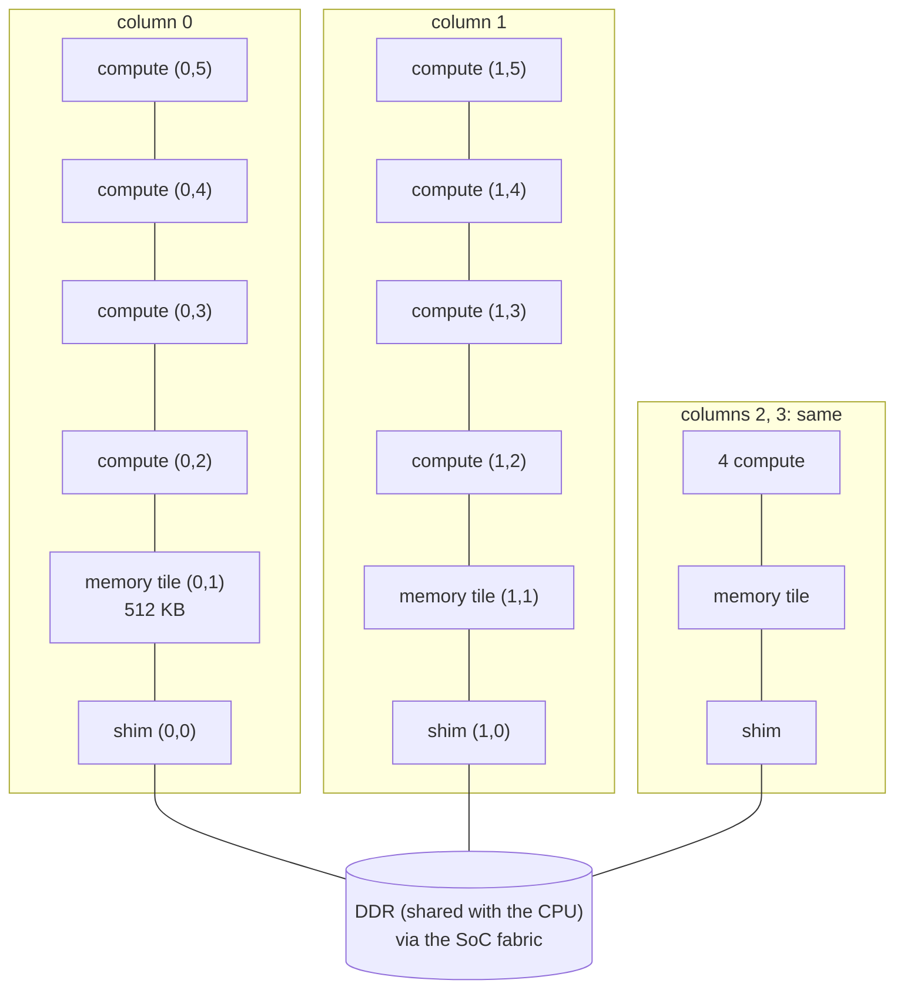
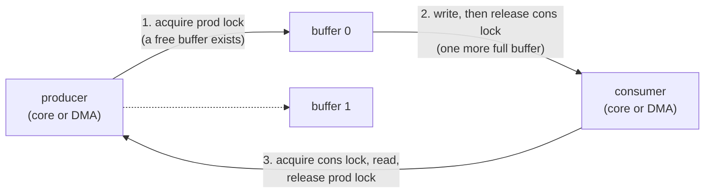
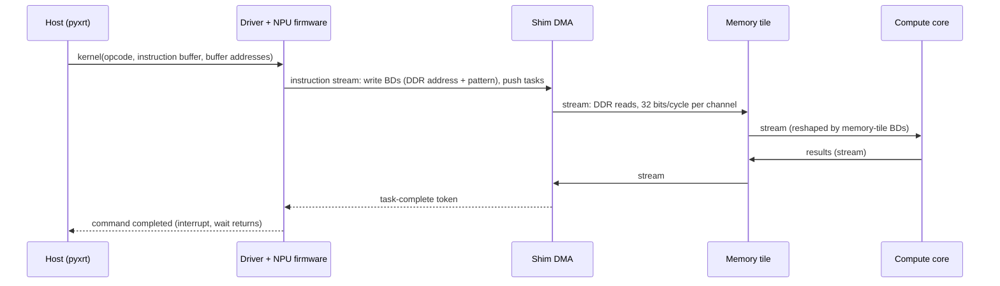

# Experiment 013: what the Phoenix NPU can do natively, how fast, and how it compares

## Question

What can the first-generation XDNA NPU in the Ryzen 9 8945HS do in hardware,
how fast is each kind of work on it, and how does that compare with the CPU
and the RTX 4060 in the same laptop? And why does even a tiny NPU call cost
a tenth of a millisecond or more?

## Short answer

* **The NPU is a matrix and stream engine.** Each of its 16 usable cores
  multiplies 8-bit integers (256 multiply-accumulates per clock cycle),
  8-bit by 4-bit integers (512), 16-bit integers (64 to 128) and BF16
  (128, accumulated in FP32) natively. Everything else is built from those
  parts: FP32 multiply, division, square roots, exp and every scalar float
  operation are software on this chip.
* **A tiny call costs about 0.13 ms** through direct pyxrt (0.115 ms for the
  bare submit-and-wait; 0.094 ms if a pyxrt run object is reused) and
  **0.75 ms** through IRON's `iron.jit` wrapper. About 0.08-0.09 ms of it is the
  command's round trip through the driver and NPU firmware, the same as
  AMD's own `xrt-smi validate` latency test (79 µs). The rest of the IRON
  figure is Python bookkeeping, mostly file-system checks.
* **The NPU does not beat a fully used CPU at anything measured here.** Its
  best results are ties or near-ties with all 16 CPU threads:
  int8 matrix multiply 1.46 TMAC/s (ONNX Runtime on 16 CPU threads: 1.70),
  BF16 matrix multiply with FP32 accumulation 0.79 TMAC/s (PyTorch BF16 on
  16 threads: 0.98), BF16 element-wise work at 32 GB/s (PyTorch on 8 CPU
  threads: the same; memory bandwidth limits both).
  It does beat the CPU at **int16** matrix multiply around 1024×1024
  (1.9 ms against 3.1 ms for the CPU's FP32 workaround and 276 ms for real
  integer math), and it beats 8 CPU threads on int8 and BF16 matrix multiply
  at that size.
* **Below roughly 1 MB of data per call, the CPU wins by 10 to 400 times**,
  because the NPU's fixed cost per call dwarfs the work. The RTX 4060 is 5 to
  100 times faster than the NPU on everything large, but copying data over
  PCIe costs it more than the NPU's whole call for bandwidth-bound work.
* The case for this NPU stays the one from experiments 010 and 012: it runs
  big, fused, long-running programs (an LLM token, a Conformer encoder) at a
  fraction of the CPU's power while leaving the CPU free. It is not a fast
  accelerator for single operations.

The rest of this document gives the details: [A](#part-a-capability-inventory)
the capability inventory, [B](#part-b-measurements) the measurements,
[C](#part-c-how-the-array-is-built) how the array is built, and
[D](#part-d-the-fixed-cost-of-one-call) where the fixed cost of a call goes,
followed by the [summary table](#summary).

## Machine and method

| | |
| --- | --- |
| Laptop | ASUS ROG Zephyrus G14 (GA403UV), Ryzen 9 8945HS (Hawk Point, Zen 4, 8 cores / 16 threads), 16 GB RAM, RTX 4060 Laptop 8 GB |
| NPU software | driver 32.0.20101.3760, firmware 1.5.5.391, XRT 2.21.0 (`xrt-smi`), XRT SDK 2.21.75 (`pyxrt`), IRON / MLIR-AIE 1.4.3 |
| CPU and GPU software | CPython 3.14.7, NumPy 2.5.4 with OpenBLAS 0.3.34, PyTorch 2.11.0+cu128 (CUDA 12.8, cuDNN 9.19), NVIDIA driver 616.92; ONNX Runtime 1.23.2 (Ryzen AI 1.7 build, CPU provider) |
| State during runs | AC power, Windows Balanced plan, NPU power mode Default. CPU about 5% busy, the CI runner containers idle, GPU idle, 2.6-2.8 GB RAM free. The NPU Dictate tray app was running but idle (`xrt-smi` showed no hardware context in use). |

`cache/lfm-env` (the PyTorch environment named in older experiments) is
broken: its base Python no longer exists. The CPU and GPU baselines here use
the system Python 3.14 install, which has PyTorch with CUDA.

**Timing.** Every number is a warm median: 3 untimed calls, then at least 10
and up to 200 timed calls within about one second. `013_results.json` has
the median, 10th and 90th percentiles and the call count for every row.

**What an NPU call includes.** Two times are reported:

* **run**: the input data is already in XRT buffers. The call is
  `kernel(...)` + `run.wait()` through [`npu_direct.py`](npu_direct.py):
  submit, the NPU reads the inputs from DDR, computes, writes the output to
  DDR, completion comes back.
* **e2e** (end to end): copy NumPy inputs into the XRT buffers, sync them,
  run, sync the output back, copy it out. This compares with a GPU call
  that includes host-to-GPU copies.

**The NPU programs.** No new NPU designs were written for this experiment.
Every NPU case is either one of AMD's IRON programming examples, unchanged
apart from the size and type parameters the example already supports, or a
repo kernel that ran cleanly in an earlier experiment (the experiment 006
BF16 GEMV, the 010 bandwidth probe, the 012 vector-math bench). They are
compiled by IRON and submitted directly through pyxrt, one case per process,
through `scripts/run_npu_timeout.ps1`. Before any hardware run, each host
buffer is checked against the element count the compiled program expects
(see [what went wrong](#what-went-wrong-along-the-way)). No run hung or timed out.

**Correctness.** Every NPU number in the tables passed its check against a
NumPy reference, run once before and once after the timed calls. The
checks are listed per case in `013_results.json`; in short: exact for
integer work, within one BF16 rounding step for element-wise BF16, AMD's
own tolerances for its approximate exp, GELU and softmax kernels, and
error below 1% of the largest output for BF16 matrix work.

**Baselines.** CPU baselines are the strongest available here and labelled:
NumPy/OpenBLAS FP32, PyTorch CPU in FP32 and BF16 (oneDNN uses the Zen 4
AVX-512 BF16 instructions), `torch._int_mm` for int8, and ONNX Runtime for int8
matrix multiply and convolution. Thread counts are stated: 8 by default,
and 16 for the matrix work, where it helps. Where a CPU baseline is weak,
the table says so. NumPy's int16 matrix multiply has no BLAS behind it
(0.2-1.7 GMAC/s), and ONNX Runtime's signed-by-signed int8 path is about
70 times slower than its unsigned-by-signed one. GPU baselines are PyTorch
CUDA, timed both with inputs already on the GPU ("compute") and with the
host-to-GPU and GPU-to-host copies included ("with copies"). Vision-model
results on the NPU are in experiments [001](001_quicktest.md),
[002](002_webcam_yolov8.md) and [003](003_model_compatibility.md) and are
not repeated here.

## Part A: capability inventory

"Native" means one hardware instruction or unit does it. "Emulated" means
it is built in software from other instructions. "Measured here" means this
experiment ran or compiled something that shows it. Main sources:
AMD AM020 (*Versal Adaptive SoC AIE-ML Architecture Manual*), the AIE API
documentation and headers shipped with IRON 1.4.3 (`aie_api/aie_doc.hpp`,
`aie_api/detail/aie2/*.hpp`), and aie-rt's NPU1 device description
(`third_party/aie-rt/driver/src/global/xaie2ipugbl_reginit.c`). Links are
under [Sources](#sources).

### A1. Vector unit: multiply and matrix modes (per core)

The AIE API exposes matrix multiply as `aie::mmul<M, K, N, TypeA, TypeB>`:
one call multiplies an M×K block by a K×N block. The shapes below are the
specializations that map to a single hardware instruction on AIE-ML
(the `C_block<..., 1>` cases in `aie_api/detail/aie2/mmul_*.hpp`). Larger
shapes exist and are built from two or more instructions.

| Operation (A × B → accumulator) | Native? | Single-instruction `mmul` shape(s) | MACs per cycle | Evidence |
| --- | --- | --- | ---: | --- |
| int8 × int4 → 32-bit | native | 4×16×8 | 512 | AM020 (512 4b×8b MACs); AIE API headers. Not measured. |
| int8 × int8 → 32-bit | native | 4×8×8 | 256 | AM020; headers. **Measured here**: int8 GEMM 1.46 TMAC/s on 16 cores |
| int16 × int8 → 32-bit | native | 4×4×8 | 128 | headers (MACs/cycle inferred from the shape) |
| int16 × int16 → 32- or 64-bit | native | 4×4×4 (64-bit acc), 4×2×8 (32-bit acc) | 64 | headers (inferred from shape). **Measured here**: int16 GEMM 0.57 TMAC/s |
| int32 × int16 → 64-bit | native | 4×2×4, 4×4×4 | 32-64 | headers |
| int32 × int32 | **emulated** (two 32×16 multiplies) | | | `aie_doc.hpp`: "32b x 32b multiplication is not natively supported on AIE-ML" |
| BF16 × BF16 → FP32 | native | 4×8×4 | 128 | AM020 (128 bfloat16 MACs, FP32 accumulation); headers. **Measured here**: 0.79 TMAC/s |
| FP32 × FP32 → FP32 | **emulated** with several BF16 multiplies | (4×8×4 API shape, multi-instruction) | | AM020 ("32-bit floating-point vector data path is not directly supported"); `aie_doc.hpp`. **Measured here**: 62 ns per 16-lane FP32 multiply vs 22 ns for a BF16 round trip (012 vbench) |
| Complex cint16 / cint32 | native | | | AM020, headers |
| Structured-sparse int8 / int16 weights | native (decompressed on load) | | | AM020; `aie_api/sparse_vector.hpp`. Not measured |
| Block floating point (bfp16) | **not available** (XDNA 2 only) | | | headers: `mmul_bfp16_bfp16.hpp` exists only for AIE2P |

Element-wise multiply (`aie::mul`) uses the same multipliers: 16 lanes of
BF16 × BF16 → FP32 per instruction (repo kernels in experiments 010 to 012
rely on this), and 32 lanes for 16-bit and 8-bit integers.

### A2. Vector unit: everything else

| Capability | Native? | Detail | Evidence |
| --- | --- | --- | --- |
| Vector registers and widths | native | 128 to 1024-bit vectors: int4 ×32-256, int8 ×16-128, int16 ×8-64, int32 ×4-32, BF16 ×8-64, FP32 ×4-32, cint16, cint32 | `aie_doc.hpp` vector table |
| Integer add / subtract / negate | native | 64 lanes × 8-bit, 32 × 16-bit, 16 × 32-bit | AM020 fixed-point vector unit |
| Integer compare, min / max, select (blend) | native | same lane counts | AM020; AIE API `max_min`, `compare`, `blend` |
| BF16 compare, min / max | native | element-wise | AM020 floating-point vector unit |
| FP32 add / subtract / negate | native, on accumulator registers | | AM020 ("addition/subtract/negate of accumulator registers in a single-precision FP32 format") |
| Shift, shuffle, permute, interleave | native | | AM020 |
| Accumulator → vector with shift, round, saturate (SRS) | native | int: 32 lanes 8b/16b ↔ 32b acc, 16 lanes 16b/32b ↔ 64b acc; float: 16 lanes FP32 acc → BF16 | AM020 |
| Rounding modes on conversion | native | floor (the **default**), ceil, round-half towards +∞ / −∞ / away from zero / towards zero, round-half-to-even, round-half-to-odd, plus towards / away from zero (new on AIE-ML) | `aie_api/aie_types.hpp`. **Measured here**: AMD's BF16 add and multiply kernels round with the default `floor`, so about a quarter of results differ from round-to-nearest-even by one step |
| Saturation modes | native | none (wrap), saturate, symmetric saturate | `aie_types.hpp` |
| BF16 → int32 vector conversion | native | 16 lanes | AM020; `aie_doc.hpp` conversion table |
| FP32 → int, int → BF16 / FP32 vector conversion | **emulated** | | `aie_doc.hpp` conversion tables |
| Reductions (sum, max, min of one vector) | built from vector add / max with shuffles | no single "reduce" instruction is documented | AIE API `reduce_add`, `reduce_max`; **measured here** with AMD's kernels |
| Lookup tables (parallel lookup) | native | used for BF16 exp, GELU, SiLU, tanh in AMD's kernel library | `aie_doc.hpp`: "Lookup table functionality is only available from AIE-ML" |
| 1/x and 1/√x on vectors | **emulated** | bit trick plus Newton steps in BF16 or FP32 | `aie_api/detail/aie2/elementary.hpp` |
| Division | **emulated** | multiply by an emulated 1/x; no divider | same |
| √x, exp, exp2, log, tanh, sin, cos on vectors | **not available** as instructions | AIE API has no AIE-ML implementation; kernels use lookup tables or polynomials (AMD's `bf16_exp`, the repo's `exp16`) | headers; AMD kernel library; **measured here**: repo `exp16` about 172 ns per 16 values, sigmoid 260 ns, swish 284 ns on one core |
| Denormal floats | **not supported** | flushed | AM020 |

### A3. Scalar unit

The scalar unit is a small 32-bit RISC processor that runs loop control and
addressing. On AIE-ML it lost the floating-point and non-linear functions of
the first AI Engine generation (AM020 lists scalar sin/cos, sqrt, inverse
sqrt, inverse and scalar float/int conversion as removed). To see what that
means in practice, small scalar functions were compiled offline with
IRON's `llvm-aie` compiler (no NPU involved), and the library calls left in
the object file were listed:

| Scalar operation in C | Compiles to | Native? |
| --- | --- | --- |
| int32 add, shift | one instruction | native |
| int32 multiply | one `mul` instruction | native |
| int64 multiply | call to `__muldi3` | emulated |
| int32 divide, modulo | calls to `__divsi3`, `__umodsi3` | emulated |
| float add | moves both values into the **vector** unit and uses its FP32 accumulator add (`vadd.f`) | native, but through the vector unit |
| float multiply | call to `__mulsf3` | emulated |
| float divide | call to `__divsf3` | emulated |
| float compare | call to `__ltsf2` | emulated |
| float ↔ int conversion | calls to `__fixsfsi`, `__floatsisf` | emulated |

This is why the repo's kernels avoid scalar float in hot loops (experiment
010's handoff: about 1 ms per layer was lost to emulated scalar float before
it was vectorized).

### A4. Data movement and the array

| Feature | Compute tile (16 used) | Memory tile (4) | Shim tile (4) | Evidence |
| --- | --- | --- | --- | --- |
| Processor | yes (VLIW scalar + vector) | no | no | AM020 |
| Memory | 64 KB data (4 banks of 16 KB as seen by software) + 16 KB program | 512 KB (16 banks), up to 30 GB/s read + 30 GB/s write | none (it reaches DDR) | AM020 |
| DMA channels | 2 stream-to-memory (in) + 2 memory-to-stream (out) | 6 in + 6 out | 2 DDR→array + 2 array→DDR | AM020; aie-rt |
| Buffer descriptors | 16 | 48 (24 reachable per channel) | 16, shared by all channels | AM020; aie-rt |
| Task queue per channel | 4 | 4 | 4 | AM020; aie-rt `StartQSizeMax = 4`. **Measured the hard way**: overflowing it caused experiment 012's hangs |
| Address generation | 3 dimensions + iteration (aie-rt says 3, AM020 says 4D with iteration offset) | 4 dimensions + iteration (AM020: "5D") | 3 dimensions + iteration (AM020: 4D) | AM020; aie-rt `NumAddrDim` |
| Zero padding, compression | compression out, decompression in | padding and compression on the way out, decompression in | | AM020 |
| Locks | 16 (6-bit counting semaphores) | 64 | 16 | AM020; aie-rt |
| Stream switch ports | 25 in / 23 out, all four directions | 18 in / 17 out, **north and south only** | to the compute array north, to DDR via the SoC fabric | AM020 |
| Stream width | 32 bits per cycle per port (4 GB/s at 1 GHz) | same | same | AM020 |
| Neighbour memory access | the core reads and writes the data memory of the tiles to its north, south and west as well as its own, with no DMA | memory-tile DMA channels 0-3 reach the east and west neighbour memory tiles | | AM020 |
| Cascade | 512-bit accumulator stream to the next core | | | AM020 (accumulator cascade); used by AMD's `cascade` matmul example. Not measured |
| Packet switching | yes: 5-bit stream ID in a 32-bit header; ports are either circuit or packet mode | yes | yes | AM020 |

The array is 4 usable columns × 6 rows: row 0 shim tiles, row 1 memory tiles,
rows 2-5 compute tiles. `xrt-smi` reports **5 columns**: the hardware has
a fifth, irregular column 0 without a shim DMA, which MLIR-AIE no longer
exposes ([Part C](#the-hidden-column-0)).

**Clock.** AMD does not publish the NPU clock for Phoenix or Hawk Point.
Taka et al. report 1 GHz for the Phoenix NPU (Ryzen 9 7940HS). Hawk Point
(8040 series, this laptop) is marketed at 16 TOPS against Phoenix's 10 with
the same design, and press reports attribute this to a higher NPU clock
(unconfirmed). One measurement here supports a clock above 1 GHz: a
single stream through one core (AMD's memcpy example, 1 column, 1 channel,
16 MB) moved **5.3 GB/s in each direction**. Stream ports carry 32 bits
per cycle, so that needs at least 1.33 GHz (inferred). Peak figures below
are therefore given per cycle, with the 1 GHz value as a lower bound.

### A5. AMD's official software support for this chip

| | Phoenix / Hawk Point (XDNA, this laptop) | Strix / Krackan (XDNA 2) |
| --- | --- | --- |
| Ryzen AI Software model support (compatibility table, Ryzen AI 1.7 to 1.9 release notes) | CNN INT8 only | CNN INT8, CNN BF16, NLP BF16, LLM (OnnxRuntime GenAI) |
| Still supported | yes; Ryzen AI 1.8 lists Phoenix and Hawk Point as supported processors | yes |
| Hardware contexts | XRT reports a nominal 6 (observed in experiment 006) | "up to 16" (Ryzen AI 1.4 release notes) |
| Open toolchain (IRON / MLIR-AIE) | supported as device `npu1` (4 columns) | supported as `npu2` (8 columns) |

So on this chip AMD's model compiler only takes quantized INT8 CNNs.
Everything this repo does in BF16 (the LLM, the Parakeet encoder) goes
through the open IRON toolchain instead.

### A6. Comparison with XDNA 2 (Ryzen AI 300)

| | XDNA (this laptop) | XDNA 2 (Strix, Krackan) | Source |
| --- | --- | --- | --- |
| Tile generation | AIE-ML ("AIE2") | AIE-MLv2 ("AIE2P" in the toolchain) | mlir-aie, Making-AIE docs |
| Compute tiles | 16 usable (4×4) + hidden column 0 (20 in hardware) | 32 (4 rows × 8 columns) | mlir-aie `Devices.md`; Taka et al. |
| int8 MACs per cycle per tile | 256 | 512 (double) | AM020; ServeTheHome; Taka et al. measured 233 vs 451 per core |
| BF16 | native 4×8×4 BF16 `mmul` (128 MACs/cycle) | adds native **block float bfp16** (8 values share an exponent, 8×8×8 `mmul`); fast BF16 matmul is done by converting to bfp16 | AIE API headers (`mmul_bfp16_bfp16.hpp`); Taka et al. |
| exp | lookup table / polynomial | native vector `exp2` instruction | AIE API headers (`aie2p/elementary.hpp`); Taka et al. |
| Scalar float ↔ int conversion | emulated | native | `aie_doc.hpp` conversion tables |
| Memory per core / per memory tile | 64 KB / 512 KB | 64 KB / 512 KB | Taka et al. |
| Clock | 1.0 GHz (Phoenix, per Taka et al.); Hawk Point not published | 1.8 GHz (Krackan, Taka et al.); another paper lists 1.3 GHz | Taka et al.; arXiv 2609.21264 |
| Marketed peak | 10 TOPS (Phoenix), 16 TOPS (Hawk Point) | 50-55 TOPS | AMD via press coverage |
| Best published GEMM | int8 6.76 TOPS, BF16 3.14 TOPS (tuned, 20 cores) | int8 38.05 TOPS, BF16 14.71 TOPS | Taka et al. |
| DDR bandwidth seen by the NPU | ~15 GB/s during GEMM (Taka et al.); 27-28 GB/s measured here with 8 streams | ~50 GB/s during GEMM | Taka et al.; this experiment |

Two things stand out. Taka et al.'s tuned Phoenix GEMM reaches 3.4 TMAC/s int8,
2.3 times the 1.46 TMAC/s of AMD's stock example measured here, so the stock
examples leave a lot on the table. And XDNA 2 is not a faster version of the
same chip: it doubles the tiles, doubles the int8 rate per tile, adds bfp16
and native exp2, and its DDR path is about twice as fast.

## Part B: measurements

All numbers are warm medians. GB/s counts bytes read plus written; GMAC/s
counts multiply-accumulates. "CPU best" is the fastest CPU row for that job;
"GPU" is PyTorch CUDA with the inputs already on the GPU, "GPU + copies"
includes the host-to-GPU and back copies. At sizes under 0.1 ms the GPU
compute times are mostly kernel-launch overhead (10-25 µs) and vary up to
2-3 times between runs as the GPU clock ramps up; where a case was run twice, the
faster run is shown.

### B1. Pure data movement

AMD's `memcpy` example copies int32 data DDR → array → DDR, either with the
DMA engines only (shim → memory tile → shim, no core) or through cores.

| Job | Bytes moved | NPU run ms | NPU GB/s | NPU e2e ms | CPU best ms | GPU ms | GPU + copies ms |
| --- | ---: | ---: | ---: | ---: | --- | ---: | ---: |
| DMA only, 1 column, 4 KB | 8 KB | 0.132 | 0.06 | 0.139 | 0.0003 (NumPy) | 0.010 | 0.029 |
| DMA only, 4 columns × 2 channels, 32 KB | 64 KB | 0.166 | 0.39 | 0.184 | 0.0008 (NumPy) | 0.010 | 0.039 |
| same, 1 MB | 2 MB | 0.198 | 10.6 | 0.523 | 0.006 (PyTorch; in cache) | 0.013 | 0.268 |
| same, 64 MB | 128 MB | 4.81 | **27.9** | 19.1 | 2.57 (NumPy, 52 GB/s) | 0.69 | 10.7 |
| through 1 core, 1 MB | 2 MB | 0.360 | 5.8 | 0.650 | 0.006 | 0.013 | 0.268 |
| through 1 core, 16 MB | 32 MB | 3.14 | 10.7 | 6.43 | 0.50 (NumPy) | 0.058 | 2.81 |
| through 8 cores, 64 MB | 128 MB | 4.58 | **29.3** | 23.0 | 2.57 (NumPy) | 0.69 | 10.7 |
| read only, 8 streams (010 probe, via `iron.jit`), 64 MB | 64 MB | 3.74 | 17.9 | | | | |

What this shows:

* The fixed cost is **0.13 ms** and the ceiling is **28-29 GB/s** (read plus
  write) for the whole array. The CPU copies at 52 GB/s from DRAM and much
  faster when the data fits in its caches; the NPU has no cache. Copying data
  is never faster on the NPU.
* The read-only probe's 17.9 GB/s includes IRON's ~0.75 ms call overhead
  (Part D). Experiment 010 measured 27 GB/s for the same probe submitted directly.
* One stream through one core sustains 5.3 GB/s each way, which implies
  an NPU clock of at least 1.33 GHz (see [A4](#a4-data-movement-and-the-array)).
* "e2e" is much slower than "run" at large sizes because copying NumPy
  arrays into XRT buffers is an extra host memcpy. Code that builds its data
  directly in XRT buffers (as experiments 010 and 012 do) does not pay it.

### B2. Element-wise BF16

| Job | Elements | NPU run ms | NPU GB/s | NPU e2e ms | CPU best ms | GPU ms | GPU + copies ms |
| --- | ---: | ---: | ---: | ---: | --- | ---: | ---: |
| SAXPY z = 3x + y, 1 core (AMD example; size fixed at 4096) | 4K | 0.135 | 0.18 | 0.158 | 0.0026 (NumPy FP32) | 0.012 | 0.062 |
| add, 4 cores | 4K | 0.153 | 0.16 | 0.173 | 0.0008 (NumPy FP32) | 0.011 | 0.057 |
| add | 256K | 0.176 | 9.0 | 0.314 | 0.013 (PyTorch FP32) | 0.015 | 0.249 |
| add | 16M | 3.12 | **32.3** | 11.2 | 3.18 (PyTorch BF16, 8 threads) | 0.50 | 8.64 |
| multiply | 4K / 256K / 16M | 0.156 / 0.194 / 3.09 | 32.6 at 16M | 0.171 / 0.317 / 10.9 | 0.0008 / 0.010 / 3.22 | 0.011 / 0.015 / 0.50 | 0.058 / 0.246 / 8.65 |
| ReLU, 8 cores | 8K / 256K / 16M | 0.159 / 0.172 / 2.43 | 27.6 at 16M | 0.170 / 0.247 / 8.76 | 0.0024 / 0.008 / 2.06 | 0.011 / 0.012 / 0.30 | 0.050 / 0.186 / 5.70 |
| GELU (lookup table), 8 cores | 8K / 256K / 16M | 0.160 / 0.289 / 9.46 | 7.1 at 16M | 0.169 / 0.358 / 15.6 | 0.012 / 0.035 / 2.43 | 0.014 / 0.015 / 0.35 | 0.056 / 0.175 / 5.71 |
| int16 × scalar, 1 core | 4K | 0.134 | 0.12 | 0.145 | | | |

SAXPY is a multiply plus an add. AMD's SAXPY example is fixed at 4096
values, so the add and multiply rows stand in for larger sizes. They have the
same data movement (two inputs, one output) and need even less arithmetic
per byte.

What this shows:

* Simple element-wise work is limited by DDR bandwidth: about 32 GB/s on
  the NPU, the same as PyTorch BF16 on 8 CPU threads. At 16 million values the NPU
  and CPU tie. Below about 1 million values the CPU wins by 10-200 times.
* GELU is compute-bound on the NPU (lookup plus arithmetic per value): 7 GB/s,
  four times slower than the CPU.
* NPU results stay within one BF16 step of the exact answer. AMD's kernels
  convert with the AIE API's default rounding (`floor`), so about 25% of add
  results and 50% of multiply results differ by one step from
  round-to-nearest-even (the PyTorch convention). Bit-exact work needs an explicit
  rounding mode, as the repo's kernels set.

### B3. Non-linear functions

| Job | Elements | NPU run ms | NPU e2e ms | CPU best ms | GPU ms | GPU + copies ms | NPU error |
| --- | ---: | ---: | ---: | --- | ---: | ---: | --- |
| exp (AMD `bf16_exp`, lookup table), 4 cores | 4K | 0.137 | 0.148 | 0.004 (PyTorch BF16) | 0.015 | 0.052 | max 1.4% relative |
| exp | 256K | 0.244 | 0.325 | 0.031 | 0.013 | 0.173 | |
| exp | 4M | 1.76 | 3.56 | 0.488 | 0.024 | 1.48 | |
| softmax over rows of 1024 (AMD), 8 cores | 8K / 256K / 4M | 0.159 / 0.247 / 1.81 | 0.170 / 0.321 / 3.57 | 0.004 / 0.038 / 0.660 | 0.015 / 0.015 / 0.038 | 0.058 / 0.169 / 1.49 | max 0.0002 absolute |

The repo's own vector math (experiment 012's `pk_vbench`, one core, 1024
FP32 inputs in [−12, 12]) measured, as nanoseconds per 16-value vector
(the 012 script labels these "cycles at 1 GHz"):

| Routine | ns per 16 values | Max relative error |
| --- | ---: | ---: |
| exp16 (polynomial) | 172 | 7.7e-5 |
| sigmoid | 260 | 2.7e-4 |
| swish (x · sigmoid x) | 284 | 2.7e-4 |
| FP32 × FP32 multiply (emulated) | 62 | 8.6e-8 |
| FP32 → BF16 → FP32 round trip | 22 | 3.9e-3 |

The CPU wins every non-linear function here by 3-40 times. The GPU wins by
far more. An accurate exp costs about 11 ns per value on one NPU core, about
0.7 ns per value with all 16 cores in use.

### B4. Reductions

| Job | Elements | NPU run ms | NPU GB/s | CPU best ms | GPU ms | GPU + copies ms |
| --- | ---: | ---: | ---: | --- | ---: | ---: |
| max, int32, 1 core | 2K | 0.129 | 0.06 | 0.0008 (NumPy) | 0.013 | 0.043 |
| max, BF16, 1 core | 2K | 0.127 | 0.03 | 0.0013 (PyTorch) | 0.013 | 0.050 |
| max, int32, 8 cores | 32K | 0.150 | 0.87 | 0.0015 (NumPy) | 0.015 | 0.095 |
| max, int32, 8 cores | 1M | 0.253 | 16.6 | 0.012 (PyTorch; in cache) | 0.026 | 0.430 |
| max, int32, 8 cores | 16M | 2.24 | **30.0** | 1.41 (PyTorch) | 0.34 | 5.74 |
| max, BF16, 8 cores | 16M | 1.27 | 26.3 | 0.41 (PyTorch BF16) | 0.067 | 2.80 |
| sum, int32, 1 core | 1K | 0.137 | 0.03 | 0.0022 (NumPy) | 0.021 | 0.053 |

A reduction reads every byte once, so the NPU reaches its DDR ceiling,
30 GB/s, at 16 million values. The CPU reads 40-80 GB/s and wins at every size.

### B5. Dot products and matrix-vector multiply

A matrix-vector multiply is a batch of dot products, and it reads every
weight once, so it is limited by memory bandwidth. Rows are the BF16 GEMV
kernel from experiment 006 (FP32 accumulation, BF16 output) and AMD's int16
`matrix_vector` example.

| Job | NPU run ms | NPU GB/s (weights) | NPU e2e ms | CPU best ms | GPU ms | GPU + copies ms |
| --- | ---: | ---: | ---: | --- | ---: | ---: |
| BF16 256×1024 (a batch of 256 dot products of length 1024), 4 cores | 0.196 | 2.7 | 0.243 | 0.009 (NumPy FP32) | 0.017 | 0.124 |
| BF16 3072×1024, 4 cores | 0.910 | 6.9 | 1.21 | 0.080 (NumPy FP32) | 0.049 | 0.632 |
| BF16 3072×1024, 1 core | 2.94 | 2.1 | 3.32 | 0.080 | 0.049 | 0.632 |
| BF16 4096×4096, 4 cores | 3.59 | 9.3 | 5.43 | 1.28 (PyTorch BF16) | 0.18 | 3.00 |
| int16 288×288 → int32, 1 core | 0.169 | 1.0 | 0.196 | 0.0037 (NumPy FP32, exact here) | | |
| int16 1024×1024 → int32, 1 core | 0.502 | 4.2 | 0.608 | 0.051 (NumPy FP32); NumPy int16: 0.598 | | |

These kernels are not the NPU's best: the 4-core experiment 006 kernel pulls
9 GB/s of weights. Experiment 010's 8-core engine streams weights at
27 GB/s (464 MB per LLM token in 17.2 ms), about the same rate as the CPU's
BF16 GEMV here (4096×4096 BF16 = 32 MB in 1.28 ms, 26 GB/s). For a single
matrix-vector product the CPU's caches decide everything below about 8 MB of
weights. For streaming weights from DRAM, NPU and CPU are about equal and
the GPU is 7 times faster once the weights are on it.

### B6. Matrix-matrix multiply

AMD's `whole_array` design uses all 16 cores. `single_core` uses one.
Sizes are square (M = K = N).

**BF16 inputs, FP32 accumulation and output**

| Size | NPU run ms | NPU TMAC/s | NPU e2e ms | NumPy FP32 (8 / 16 threads) | PyTorch BF16 (8 / 16 threads) | GPU BF16 | GPU + copies | NPU error (of max) |
| ---: | ---: | ---: | ---: | --- | --- | ---: | ---: | --- |
| 256, 1 core | 0.423 | 0.040 | 0.448 | | | | | 3e-7 |
| 512, 1 core | 2.21 | 0.061 | 2.58 | | | | | 5e-7 |
| 256, 16 cores | 0.180 | 0.094 | 0.229 | 0.113 / 0.139 ms | 0.056 / **0.047** ms | 0.024 | 0.150 | 3e-7 |
| 1024, 16 cores | 1.36 | **0.79** | 2.15 | 4.26 / 3.11 ms | 1.92 / **1.09** ms | 0.10 | 0.78 | 7e-7 |
| 2048, 16 cores | 18.1 | 0.47 | 21.5 | 32.3 / 26.7 ms | 16.3 / **13.9** ms | 0.64 | 2.82 | 1.2e-6 |

**int8 inputs, int32 output**

| Size | NPU run ms | NPU TMAC/s | NPU e2e ms | ONNX Runtime u8×s8 (8 / 16 threads) | PyTorch `_int_mm` (8 threads) | GPU int8 | GPU + copies |
| ---: | ---: | ---: | ---: | --- | --- | ---: | ---: |
| 256 | 0.173 | 0.097 | 0.220 | **0.019** / 0.026 ms | 0.023 ms | 0.026 | 0.151 |
| 1024 | 0.737 | **1.46** | 1.95 | 1.04 / **0.631** ms | 0.949 ms | 0.107 | 0.773 |
| 2048 | 6.42 | 1.34 | 9.79 | 8.45 / **4.85** ms | 8.10 ms | 0.628 | 2.78 |

ONNX Runtime's signed int8 × signed int8 path, the same types as the NPU,
manages only 14-25 GMAC/s in this build. The unsigned × signed path is what
quantized models actually use on x86, so that is the baseline.

**int16 inputs, int32 output** (AMD's default 32×32×32 tile)

| Size | NPU run ms | NPU TMAC/s | NPU e2e ms | NumPy int16 (weak) | PyTorch int32 | NumPy FP32 workaround (8 / 16 threads) | GPU |
| ---: | ---: | ---: | ---: | ---: | ---: | --- | --- |
| 256 | 0.183 | 0.092 | 0.231 | 9.8 ms | 4.3 ms | **0.112** / 0.139 ms | no int16 GEMM in PyTorch |
| 1024 | **1.88** | 0.57 | 3.26 | 1528 ms | 276 ms | 4.60 / 3.11 ms | |
| 2048 | 43.2 | 0.20 | 52.5 | 37,100 ms | 2295 ms | 33.9 / **26.7** ms | |

The FP32 workaround is only exact while every sum stays below 2^24, which
held for these test values but does not in general.

What this shows:

* The NPU's best matrix rates with AMD's stock design are **1.46 TMAC/s int8**
  (2.9 TOPS), **0.79 TMAC/s BF16** and **0.57 TMAC/s int16**, all at
  1024×1024. Per core that is 91, 49 and 36 MACs per nanosecond, 36%, 39% and
  56% of the per-cycle peak if the clock were 1 GHz, and lower still if it is
  faster. Taka et al.'s tuned design reaches 3.4 TMAC/s int8 on a Phoenix
  NPU, so the hardware can do better than the example.
* At 2048 the stock design slows down: it re-reads the input matrices for
  each block of output rows, and its small tiles (32×32×32 for int16) need many
  DMA tasks. The int16 case falls from 0.57 to 0.20 TMAC/s.
* Against 8 CPU threads, the NPU wins int8 and BF16 at 1024 and int8 at 2048.
  Against 16 threads, it only wins int16 at 1024. The GPU is 7-20 times
  faster than the NPU even when its copies are included.
* **AMD's BF16-output configuration is inaccurate for large K.** With BF16
  output (the example's usual setting), the running sums are rounded to
  BF16 after every 64-wide slice of K. The maximum error grew from 1% of
  the largest output at K = 256 to 3.1% at 1024 and 6.5% at 2048.
  That run was faster (1.05 ms at 1024), but it failed the 1% accuracy
  check, so it is not used in any table. With FP32 output, the error is
  around 1e-6.

### B7. int8 convolution

AMD's `conv2d` example: a 1×1 convolution, int8 activations and weights,
int8 output (shift by 10 bits and saturate), on one core.

| Shape (width × height × in → out channels) | MACs | NPU run ms | NPU GMAC/s | NPU e2e ms | ONNX Runtime u8×s8 QLinearConv (8 / 16 threads) | PyTorch FP32 conv (8 threads) | GPU best | GPU + copies | NPU exact |
| --- | ---: | ---: | ---: | ---: | --- | --- | ---: | ---: | --- |
| 32×4×64→64 | 0.5 M | 0.168 | 3.1 | 0.180 | **0.018** / 0.036 ms | 0.0085 ms | 0.020 | 0.082 | 99.95% (rest ±1) |
| 32×32×64→64 | 4.2 M | 0.350 | 12.0 | 0.399 | **0.028** / 0.074 ms | 0.084 ms | 0.023 | 0.124 | 99.95% (rest ±1) |
| 32×128×128→128 | 67 M | 3.30 | 20.4 | 3.41 | 0.153 / **0.107** ms | 0.356 ms | 0.034 | 0.352 | 99.95% (rest ±1) |

A single core at 20 GMAC/s is 8% of its 256 MACs-per-cycle int8 peak:
this example processes one image row at a time and is not tuned. A width-8
input (8×8×64→64) gave completely wrong outputs (every value off, up to
49 steps) while the 32-wide shapes were correct to ±1. This was not
investigated further. It looks like an untested shape in the kernel, not
a hardware limit. The CPU wins every convolution here by 10-30 times.

### What went wrong along the way

* A case's host buffers were bound in the wrong order (AMD's
  `vector_scalar_mul` takes the output as its second argument), so the NPU
  DMA wrote a 4096-value result into a 4-byte buffer. The run completed
  without a visible error, which is the danger: XRT does not check that a
  buffer is as large as the transfer that targets it. The harness now
  compares every buffer with the element counts recorded in the compiled
  program before it creates a hardware context, and refuses to run on a
  mismatch. All 61 cases pass that check.
* The first correctness check for BF16 add was too strict (it demanded
  round-to-nearest-even). It was replaced by "within one BF16 step", and the
  cases were rerun.

## Part C: how the array is built

This part is for learning the hardware one level below "compute, memory and
shim tiles". Facts are from AM020, the MLIR-AIE documentation and aie-rt
unless marked *inferred*.

### The grid



Phoenix has a 4 + 1 column array: 4 regular columns (IRON numbers them 0-3,
as in the diagram, with tiles written as (column, row)) and one irregular
hardware column, described [below](#the-hidden-column-0). Each regular column is one shim tile at the
bottom (row 0), one memory tile (row 1) and four compute tiles (rows 2-5).
The whole array runs on one clock. All tiles have a stream switch, and the
switches form a grid of 32-bit streaming links between neighbours.

### What is inside each tile

**Compute tile.** A VLIW processor (one instruction issues several
operations per cycle: scalar, two loads, one store, a vector operation, moves)
with:

* a 32-bit scalar unit (integers, addressing, loops; no floating point),
* a vector unit with 512-bit vector registers and wide accumulator
  registers, a multiplier array (256 int8 MACs per cycle), a separate
  add / compare / shuffle unit, and the conversion (SRS / UPS) paths,
* 16 KB of program memory (all code for that core must fit; the 010
  engine uses 16,228 bytes of it),
* 64 KB of data memory in banks, readable by the core with two 256-bit loads and one
  256-bit store per cycle (AM020 says "two load units and a store unit"; the
  widths are *inferred* from the 512-bit vector width and bank layout),
* a DMA engine with 2 input and 2 output channels and 16 buffer descriptors,
* 16 locks,
* a stream switch.

The core can also read and write the data memory of its north, south and
west neighbours directly, with no DMA. IRON uses this when producer and
consumer of an ObjectFifo sit next to each other: the buffers live in
shared memory, and only locks change hands.

**Memory tile.** 512 KB of memory, no processor. Its job is staging and
reshaping: 6 input and 6 output DMA channels, 48 buffer descriptors, 64
locks, and address generators that walk up to four dimensions with strides.
That is how it can transpose, tile, pad and interleave data while copying
it (`dims_to_stream` in IRON). Its stream switch only connects north and
south. Its DMA channels 0-3 can also reach the memory of the east and west
memory tiles.

**Shim tile.** No memory and no processor. It turns streams into DDR
reads and writes: 2 DDR → array and 2 array → DDR DMA channels, 16 shared
buffer descriptors, 16 locks, and a 4-entry task queue per channel. Each
channel moves 4 bytes per cycle. Its DMA reaches DDR through the SoC's
memory fabric. The NPU has no cache: every byte from DDR is an explicit
transfer.

### How tiles are connected: streams, circuits and packets

Each stream switch has input ("slave") and output ("master") ports:
to the four neighbours, to its own DMA channels and core, plus trace and
control ports. A compute tile has 25 inputs and 23 outputs. A port is
configured in one of two modes:

* **Circuit-switched**: a fixed path from one source to one or more
  destinations (broadcast), set up when the program loads. Latency is fixed,
  and the path owns the ports it crosses. ObjectFifos use this by default.
* **Packet-switched**: several logical streams share physical ports. Each
  packet starts with a 32-bit header carrying a 5-bit stream ID (plus source
  row and column), and arbiters at each switch route packets by ID. It saves
  ports at the cost of fixed latency.

Every link carries 32 bits per cycle, so 4 GB/s at 1 GHz. A column has
6 links going north and 4 going south between neighbouring tiles. This is why
experiment 010 found that 16 separate DDR streams do not fit: each shim
has only 2 DDR → array channels, so 8 streams fill all 4 columns.

### DMA, buffer descriptors and task queues

A DMA channel moves data between a tile's memory (or DDR for a shim) and
a stream. It is programmed with **buffer descriptors (BDs)**. A BD holds a
start address, a length, up to 3-4 dimensions of strides and wraps (so one
BD can walk a sub-matrix), a pointer to the next BD (to chain or loop), and
which locks to acquire before and release after. A channel runs a chain of
BDs as one **task**. Tasks are queued per channel (4 deep on every tile type), and a
finished task can send a task-complete token, which the host's instruction
stream can wait on. Pushing a fifth task into a full queue does not block.
The push is dropped, and anything waiting on that transfer waits forever.
That is the hang experiment 012 hit.

### Locks and how an ObjectFifo is built from them

A lock is a small counting semaphore (6-bit value). A core or DMA
*acquires* a lock (waits until its value is high enough, then subtracts)
and *releases* it (adds). An IRON **ObjectFifo** of depth 2 between a
producer and a consumer becomes:



* two buffers (`depth = 2`) in the memory both sides can reach,
* a "producer" lock initialized to 2 (free slots) and a "consumer" lock
  initialized to 0 (full slots),
* the producer acquires the producer lock, fills the next buffer, and releases the
  consumer lock; the consumer acquires the consumer lock, reads, and releases the
  producer lock, rotating through the buffers.

When producer and consumer are not neighbours, the lowering adds DMA
programs: the producer's DMA reads the full buffer into a stream, the
stream switches route it, and the consumer's DMA writes it into the
consumer's buffers, with each DMA's BDs acquiring and releasing the same kind of
locks. A link through a memory tile (`forward`, `split`, `join`) adds a
buffer pool there. Broadcast is a circuit with several destinations
(MLIR-AIE `ObjectFifoLowering.md`).

### How data gets between DDR and the array



The program is fixed when it is loaded: core code, stream routes, lock and
buffer setup, all in the xclbin. What varies per call is the **runtime
sequence**, a short instruction stream (`insts.bin`, 300 bytes to 85 KB in
this experiment). For each transfer it writes shim BDs with the actual DDR
addresses of the host buffers, pushes tasks, and waits on their
completion tokens. The NPU firmware executes this stream. The cores run their
loops independently and simply block on locks until data arrives.

### What each tile type can and cannot do

| | Can | Cannot |
| --- | --- | --- |
| Compute tile | vector and matrix arithmetic, 64 KB local data, read neighbours' memory, run its own loop, DMA in / out of its memory | reach DDR directly; hold more than 16 KB of code; do scalar float in hardware; use more than 2 input + 2 output DMA channels |
| Memory tile | buffer 512 KB, reshape (up to 4D access patterns, padding), fan out (broadcast) and fan in (join) streams, reach neighbouring memory tiles | compute; connect east-west by stream |
| Shim tile | DDR ↔ stream transfers with 3-4D access patterns, 4 queued tasks per channel | compute; buffer data; run more than 2 transfers each way at once |

### The hidden column 0

`xrt-smi` reports 5 columns. Phoenix's array has a fifth column at the
left edge, hardware column 0. (IRON's columns 0-3 are the four regular
hardware columns next to it; that the driver places programs there is *inferred*.) MLIR-AIE's device list only says it "is irregular and
no longer exposed" (`docs/Devices.md`), and the current target model
describes NPU1 with 4 regular columns, so IRON programs see 4 columns. What
makes it irregular is not documented there. The likely reason (*inferred*)
is that its bottom interface tile lacks the DDR DMA the other shims have,
so its compute tiles could only be fed through neighbouring columns. AMD's
marketing figure (10 TOPS for Phoenix) and Taka et al.'s "4×5, 20 cores"
include it: 20 cores × 256 MACs × 2 operations × 1 GHz = 10.2 TOPS
(*inferred* arithmetic). On Hawk Point, 16 TOPS with the same 20 cores would
mean about 1.56 GHz (*inferred*; it fits the ≥ 1.33 GHz measured in B1).
Ryzen AI's model flows use their own overlays (`4x4.xclbin` for Phoenix);
whether they use column 0 is not documented.

## Part D: the fixed cost of one call

Experiment 005 measured a 4096-value BF16 SAXPY at **0.758 ms** through
`iron.jit` and 0.018 ms in NumPy. Here is where such a call's time goes. Probe:
[`013_call_overhead.py`](013_call_overhead.py) on AMD's smallest program,
a 4 KB DMA-only memcpy (300-byte instruction stream, no core involved).

### D1. Direct pyxrt, step by step

| Step | Median | How measured |
| --- | ---: | --- |
| One-time: open device | 0.15 ms | timed |
| One-time: read xclbin file | 0.49 ms | timed |
| One-time: create the hardware context (loads the program into the array) | **42 ms** | timed |
| One-time: create kernel object, instruction buffer, two buffers | 0.24 ms | timed |
| Per call: Python → pyxrt binding overhead | 0.4 µs | timed with a trivial pyxrt call |
| Per call: `kernel(...)` returns (creates a run object, sets 5 arguments, submits the command to the driver) | **26 µs** | timed |
| Per call: `run.wait()` (firmware runs the instruction stream, DMA moves 2 × 4 KB, completion interrupt, the waiting thread wakes) | **88 µs** | timed |
| Per call total | **115 µs** (p10 113, p90 145, n = 400) | |
| Same with a reused `pyxrt.run` object (arguments set once; `start()` + `wait()`) | **94 µs** (start 6 µs + wait 88 µs) | timed |
| Buffer sync, 4 KB / 1 MB / 16 MB / 64 MB | 0.8 / 11 / 60 / 61 µs | timed; see below |
| AMD `xrt-smi validate` latency test (C++ loop, its own tiny instruction stream) | **79 µs** average | AMD tool, NPU switched to Performance mode for the test |
| AMD `xrt-smi validate` throughput test (many commands in flight) | 28,639 commands/s = **35 µs** per command | AMD tool, Performance mode |

What the pieces mean:

* **The ~90 µs `xrt-smi` figure** (90.3 µs in experiment 005, 79 µs today)
  is AMD's C++ measurement of one command's round trip with a near-empty
  instruction stream. Direct pyxrt's `wait()` (88 µs in the Default power mode)
  is the same thing seen from Python. It is not Python overhead and not
  data movement. It is the path from the driver's submission through the NPU's
  command processor (firmware) to the completion interrupt and the waking
  thread.
* **Pipelining splits that round trip in two (inferred).** With many
  commands in flight, the NPU completes one every 35 µs. So about 35 µs per
  command is work on the NPU side (the firmware fetching and executing the
  command and its instruction stream, configuring and starting DMA, and
  detecting completion). The remaining ~45-50 µs of the single-command latency is
  the host side (the ioctl, scheduling, the interrupt and the thread wake-up),
  which overlaps when several commands are queued. These two numbers come from
  AMD's tool. The split between firmware, DMA setup and interrupt inside the
  35 µs could not be measured with user-level tools.
* **`kernel(...)` costs 20 µs more than `run.start()`** because pyxrt
  builds a run object and binds every argument on each call. Reusing one run
  object saves that.
* **Data movement inside a tiny call is negligible**: 8 KB at even 4 GB/s
  is 2 µs.
* **Buffer syncs are cheap.** NPU buffers are host memory shared with the
  NPU, so a sync is a CPU cache flush or invalidate, not a copy: 0.8 µs for
  4 KB, 11 µs for 1 MB. Above 16 MB it stays at about 60 µs, which suggests
  the driver switches to flushing the whole cache (inferred).

### D2. IRON's `iron.jit` call path

The same program called the IRON way (`memcpy(a, b, size=..., ...)` with
IRON tensors) took **751 µs** (median, n = 200). Wall-clock timers around
IRON's own functions (300 calls, means; total mean 859 µs) gave:

| Part of an `iron.jit` call | Mean per call |
| --- | ---: |
| Build a new `CompilableDesign` for the call's compile-time arguments (`specialize`: signature introspection, frozen copies) | 80 µs |
| `runtime.load`: check the xclbin and insts files exist, resolve their paths, read their timestamps, look up the cached context and kernel, list the kernels in the xclbin | 425 µs |
| ... of which the file-system checks alone (2 × `Path.resolve`, `exists`, `is_file`, `stat` on Windows; timed standalone) | ~310 µs |
| `runtime.run`: sync arguments, check the buffer count against the xclbin metadata, then `kernel(...)` + `wait()` (~115 µs of this) | 202 µs |
| `check_device_consistency` and other wrapper code (argument splitting, cache keys) | ~150 µs |

So **about 85% of an `iron.jit` call is host-side Python**, and the largest
single item is checking the compiled files on disk on every call. Windows
file-system calls are slow, and file-system filters such as antivirus
scanners make them slower (*inferred*). The NPU part is the same ~115 µs as
the direct path. The profile with Python's `cProfile` is saved in
`cache/013/iron_profile.txt`, but its attribution was distorted by the
profiler's own overhead, so the timer table above is the one to trust.

### D3. How the cost grows with payload and instruction-stream length

**Payload** (AMD's DMA-only memcpy, run time):

| Bytes moved | Run | Model: 0.13 ms + bytes / 28 GB/s |
| ---: | ---: | ---: |
| 8 KB (1 column) | 0.132 ms | 0.130 ms |
| 64 KB (4 columns × 2 channels: 8 fills, 8 drains) | 0.166 ms | 0.132 ms |
| 2 MB | 0.198 ms | 0.205 ms |
| 128 MB | 4.81 ms | 4.92 ms |

A call costs about **0.13 ms plus its data at 28 GB/s**. The 64 KB case is
34 µs above the model because its instruction stream sets up 16 transfers
and waits on 8 of them, against 2 transfers and 1 wait in the 8 KB case.

**Instruction-stream length** (experiment 010's bandwidth probe, 8 cores
reading the same 8 MB, split into more and more DMA tasks; one process
each):

| Fills per core | Task groups (8 transfers + 1 wait each) | Instruction bytes | Run | Extra vs 1 fill |
| ---: | ---: | ---: | ---: | ---: |
| 1 | 1 | 1,984 | 394 µs | |
| 4 | 4 | 5,920 | 427 µs | +33 µs |
| 16 | 16 | 21,664 | 567 µs | +173 µs |
| 64 | 64 | 84,640 | 1,308 µs | +914 µs |

Each extra group of 8 DMA transfers plus one wait costs **11-15 µs**, or
about **11 ns per instruction byte** (about 45 ns per 32-bit instruction
word). How that splits between the firmware decoding instructions and
waiting for DMA completions could not be separated with these programs.
A variant with 4 KB fills was refused at compile time and not run.

### D4. Putting it together

For a 4096-value BF16 SAXPY (12 KB of data):

| Path | Per call | Where the time goes |
| --- | ---: | --- |
| NumPy FP32 on the CPU | 0.003 ms | arithmetic in cache |
| NPU, direct pyxrt, reused run object | ~0.10 ms (*estimated* from D1) | ~45-50 µs host round trip + ~35 µs NPU command processing + a few µs data |
| NPU, direct pyxrt, `kernel(...)` each call | 0.135 ms (measured, B2) | + 20 µs argument binding + ~15 µs Python harness |
| NPU via `iron.jit` | 0.75 ms (experiment 005; 0.75 ms measured here for memcpy) | + ~0.6 ms of IRON Python bookkeeping |

The NPU needs a job of at least a few hundred microseconds of real work per
call before this fixed cost stops dominating. In practice that means fused
programs: experiment 010 runs a whole LLM token (14 layers) in one 17 ms
submission, and experiment 012 runs four Conformer layers per submission.

## Summary

Per operation class: the NPU's best measured result against the best CPU
result and the GPU, and the job size at which the NPU starts to win.
"8T" and "16T" are CPU thread counts.

| Operation | NPU best (size) | CPU best | GPU (compute / with copies) | NPU starts to win at |
| --- | --- | --- | --- | --- |
| Tiny call of any kind | 0.13 ms direct, 0.75 ms `iron.jit` | 0.3-5 µs | 10-25 µs / 30-60 µs | never |
| Copy (DDR → DDR) | 28-29 GB/s (64 MB) | 52 GB/s from DRAM, more in cache | 195 GB/s on-card / 12 GB/s over PCIe | never (beats the GPU with copies from about 1 MB) |
| Element-wise BF16 (add, multiply, ReLU, SAXPY) | 32 GB/s (16M values) | 32 GB/s (PyTorch BF16, 8T) | 200 GB/s / 12 GB/s | ties the CPU at ~16M values, never wins |
| Non-linear (exp, GELU, softmax) | exp 2.4 G values/s, GELU 1.8 G/s | 3-9 times faster | 10-50 times faster | never |
| Reductions (max, sum) | 30 GB/s (16M int32) | 40-80 GB/s | 200-500 GB/s | never |
| Matrix-vector (BF16 weights) | 9 GB/s with the 006 kernel; 27 GB/s in experiment 010's engine | 26 GB/s (PyTorch BF16) | 190 GB/s on-card | never with these kernels; the 010 engine ties the CPU |
| Matrix multiply, BF16 → FP32 | 0.79 TMAC/s (1024) | 0.98 TMAC/s (PyTorch BF16, 16T); 0.56 (8T) | 10.6-13.4 TMAC/s / 1.4-3.0 | beats 8T at 1024 only; never beats 16T |
| Matrix multiply, int8 → int32 | 1.46 TMAC/s (1024) | 1.70-1.77 TMAC/s (ONNX Runtime u8×s8, 16T); 1.0-1.1 (8T) | 10-13.7 TMAC/s / 1.4-3.1 | beats 8T from 1024; never beats 16T |
| Matrix multiply, int16 → int32 | 0.57 TMAC/s (1024) | 0.35 TMAC/s FP32 workaround (16T); real int16 ≤ 0.004 | no int16 matmul in PyTorch | wins around 1024 (loses at 256 and 2048 with AMD's small tiles) |
| int8 1×1 convolution (1 core) | 20 GMAC/s | 625 GMAC/s (ONNX Runtime, 16T) | 2 TMAC/s | never (this single-core example) |
| Fixed cost hidden in a fused program | 17 ms LLM token, 185 ms per 10 s of audio (experiments 010, 012) | 30 ms per token (PyTorch BF16); 500 ms per 10 s (FP32) | | the NPU's real use: large fused work with the CPU left free |

The honest picture: with AMD's stock examples, this NPU is roughly as fast
as half of this laptop's CPU at the things it does best (int8, BF16 and int16
matrix multiply, BF16 streaming), and slower at everything else. Tuned
designs can reach about twice the stock int8 rate (Taka et al.). Its
advantages are elsewhere: it runs on its own power budget, it leaves the CPU
and GPU free, and the experiments in this repo that matter (010, 012) use
it for long fused programs where the 0.1 ms call cost disappears.
Power was not measured in this experiment.

## Not measured

* NPU power or energy for any of these jobs (only experiment 006 used
  the battery method, for an older engine).
* int8 × int4 and sparse matrix modes: no AMD example exercises them on
  Phoenix in IRON 1.4.3.
* The cascade matmul example and packet-switched designs: they would be
  new configurations for this laptop, so they were left out under the safety rules.
* The NPU clock: not exposed by the driver or `xrt-smi`. The ≥ 1.33 GHz figure is
  an inference from stream bandwidth.
* Splitting the 35 µs of NPU-side command processing into firmware, DMA
  setup and interrupt time: needs firmware or trace tools not used here.
* The width-8 convolution failure: not debugged.

## Reproduce

From the repo root, after the setup in [docs/setup.md](../docs/setup.md):

```powershell
# NPU: all cases, one process each, stops at the first sign of a hang
powershell -NoProfile -File experiments\013_run_npu.ps1
# NPU: one case
powershell -NoProfile -File scripts\run_npu_timeout.ps1 -Script experiments\013_npu_bench.py -ScriptArgs "gemm_i8_wa_1024"
# Part D (one mode per process)
powershell -NoProfile -File scripts\run_npu_timeout.ps1 -Script experiments\013_call_overhead.py -ScriptArgs direct
powershell -NoProfile -File scripts\run_npu_timeout.ps1 -Script experiments\013_call_overhead.py -ScriptArgs iron_timed
powershell -NoProfile -File scripts\run_npu_timeout.ps1 -Script experiments\013_call_overhead.py -ScriptArgs "insts 64"
powershell -NoProfile -File scripts\run_npu_timeout.ps1 -Script experiments\012_vbench.py
& 'C:\Windows\System32\AMD\xrt-smi.exe' validate --run latency --verbose
# CPU and GPU (system Python with CUDA PyTorch), then ONNX Runtime int8 (Ryzen AI env)
python experiments\013_cpu_gpu_bench.py --threads 8
python experiments\013_cpu_gpu_bench.py --threads 16 --only cpu --ops gemm,gemv --tag threads16
& "$env:USERPROFILE\miniforge3\envs\ryzen-ai-1.7.0\python.exe" experiments\013_ort_int8_bench.py --threads 8
& "$env:USERPROFILE\miniforge3\envs\ryzen-ai-1.7.0\python.exe" experiments\013_ort_int8_bench.py --threads 16
# Gather into experiments\013_results.json
python experiments\013_collect.py
```

| File | What it does |
| --- | --- |
| [`013_npu_bench.py`](013_npu_bench.py) | NPU cases (AMD examples and repo kernels), correctness checks, run and e2e timing |
| [`013_run_npu.ps1`](013_run_npu.ps1) | runs NPU cases one per process with a timeout, stops on any hang sign |
| [`013_call_overhead.py`](013_call_overhead.py) | Part D probes: pyxrt steps, IRON path, instruction-stream length |
| [`013_cpu_gpu_bench.py`](013_cpu_gpu_bench.py) | NumPy, PyTorch CPU and PyTorch CUDA baselines |
| [`013_ort_int8_bench.py`](013_ort_int8_bench.py) | ONNX Runtime int8 matmul and convolution baselines |
| [`013_collect.py`](013_collect.py) | merges the raw results into `013_results.json` |
| [`013_results.json`](013_results.json) | every raw number: NPU rows with checks, CPU/GPU rows, Part D, 012 vbench, `xrt-smi` |

## Sources

* AMD, *Versal Adaptive SoC AIE-ML Architecture Manual* (AM020):
  [overview](https://docs.amd.com/r/en-US/am020-versal-aie-ml/Overview),
  [AIE-ML processor](https://docs.amd.com/r/en-US/am020-versal-aie-ml/AIE-ML-Processor?contentId=trxDGJPblCC3vyE98T7Rzg),
  [fixed-point vector unit](https://docs.amd.com/r/en-US/am020-versal-aie-ml/Fixed-Point-Vector-Unit?contentId=XVvswhj0W2WbJClWj50yLw),
  [floating-point vector unit](https://docs.amd.com/r/en-US/am020-versal-aie-ml/Floating-Point-Vector-Unit?contentId=m9Tjq5_1YRKdRG3fVh1l6w),
  [tile architecture](https://docs.amd.com/r/en-US/am020-versal-aie-ml/AIE-ML-Tile-Architecture?contentId=gioqxqtA4nRTG6I7vry4rA),
  [memory module](https://docs.amd.com/r/en-US/am020-versal-aie-ml/AIE-ML-Memory-Module?contentId=AKu4bONAAT3ghnvOjmgFTA),
  [memory tile](https://docs.amd.com/r/en-US/am020-versal-aie-ml/AIE-ML-Memory-Tile-Overview-and-Features?contentId=tSNfhXRjh5ZM4OE77ZPuug),
  [stream switch](https://docs.amd.com/r/en-US/am020-versal-aie-ml/AXI4-Stream-Interconnect?contentId=2a1tDsjZSw_PZK9Oyb84Dg),
  [array interface](https://docs.amd.com/r/en-US/am020-versal-aie-ml/AIE-ML-Array-Interface?contentId=w3rFtwY9RMnPJcl4t6BitA),
  [array interface DMA](https://docs.amd.com/r/en-US/am020-versal-aie-ml/Array-Interface-DMA-Memory-Mapped-AXI4-Master-Interface?contentId=4R3CxZXWjn_u7obldDLg~A).
  AM020 describes the Versal AIE-ML tile. That Phoenix's NPU uses the same
  tile is stated by MLIR-AIE (device `npu1`, AIE2 target) and the AIE API
  docs ("AIE-ML / XDNA1").
* AIE API documentation and headers shipped with IRON 1.4.3:
  `mlir_aie/include/aie_api/aie_doc.hpp`, `aie_types.hpp`,
  `detail/aie2/mmul_*.hpp`, `detail/aie2/elementary.hpp`,
  `detail/aie2p/mmul_bfp16_bfp16.hpp`, `detail/aie2p/elementary.hpp`.
* aie-rt NPU1 device parameters: `third_party/aie-rt/driver/src/global/xaie2ipugbl_reginit.c`
  in the [mlir-aie](https://github.com/Xilinx/mlir-aie) checkout.
* MLIR-AIE docs: [Devices](https://github.com/Xilinx/mlir-aie/blob/main/docs/Devices.md),
  [ObjectFifo lowering](https://github.com/Xilinx/mlir-aie/blob/main/docs/ObjectFifoLowering.md),
  [programming guide](https://github.com/Xilinx/mlir-aie/tree/main/programming_guide).
* AMD Ryzen AI Software [release notes](https://ryzenai.docs.amd.com/en/latest/relnotes.html)
  (model compatibility table, supported processors, hardware contexts).
* E. Taka et al., "Striking the Balance: GEMM Performance Optimization
  Across Generations of Ryzen AI NPUs", [arXiv:2512.13282](https://arxiv.org/abs/2512.13282) (2025):
  XDNA (Ryzen 9 7940HS) vs XDNA 2 (Ryzen AI 7 350) parameters and GEMM results.
* "Programming AMD XDNA NPUs with Open-source Compiler Tools: A FlashAttention Case Study",
  [arXiv:2609.21264](https://arxiv.org/pdf/2609.21264) (clock and exp comparison).
* XDNA 2 overviews: [ServeTheHome](https://www.servethehome.com/architecture-trifecta-amd-zen-5-rdna-3-5-and-xdna-2/amd-xdna-to-xdna-2-architecture/),
  [AnandTech](https://at-web1.www.anandtech.com/show/21469/amd-details-ryzen-ai-300-series-for-mobile-strix-point-with-rdna-35-igpu-xdna-2-npu/2),
  [Making-AIE docs](https://making-aie-dev-easier-readthedocs.readthedocs.io/en/latest/setup_and_explanation.html).
* Hawk Point NPU: [Tom's Hardware](https://www.tomshardware.com/pc-components/cpus/the-refresh-that-wasnt-amd-announces-hawk-point-ryzen-8040-series-with-zen-4-rdna3-and-xdna-teases-strix-point)
  (AMD does not publish NPU clocks), [TechPowerUp](https://techpowerup.com/316436/amd-ryzen-8040-series-hawk-point-mobile-processors-announced-with-a-faster-npu) (16 vs 10 TOPS).
* Not found: an AMD document giving the Phoenix or Hawk Point NPU clock,
  the per-cycle load/store widths of the AIE-ML core, or whether Ryzen AI's
  Phoenix overlays use column 0.
